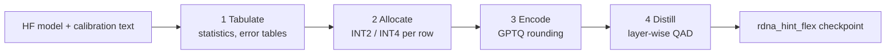

# hi2: quantizer for the rdna_hint_flex weight format

`hi2` converts a Hugging Face model into a **rdna_hint_flex** checkpoint. The format stores
each weight row as INT2 or INT4 (INT8 on request). It adds block parameters, an optional
smoothing vector, and an order-16 Hadamard rotation. The format is made for AMD RDNA2
GPUs (gfx1030), where the decode kernel reads about 93 % of the memory bandwidth.

The tool picks INT2 where a row matters less and INT4 where it matters more. You do not
set a bit rate. You set a quality target, and the tool reports the bit rate it reached.



## Quick start

Install the requirements: Python 3.10 or later, `torch`, `safetensors`, `regex`,
`transformers`.

```bash
pip install -e .
hi2 quantize  <hf_model_dir> <out_dir> --calib calib.txt          # PTQ + QAD + final KL
hi2 quantize  <hf_model_dir> <out_dir> --calib calib.txt --target-bpw 3.0   # the compact recipe
hi2 verify    <hf_model_dir> <out_dir>                            # reload and compare
hi2 eval      <hf_model_dir> <out_dir> --text heldout.txt         # ppl, KLD, top-1
hi2 size      <out_dir> --src <hf_model_dir>                      # where the bytes go
hi2 calib     calib.txt docs.txt:2 chat.jsonl:1 --holdout heldout.txt   # mixed-domain text
```

`python -m hi2 ...` works too. The default run does PTQ, then QAD (quantization-aware
distillation) on every layer with the `default` preset (300 steps a layer), then the 200-step
final logit-KL phase; that is the recipe the 27B measurement favours (docs KLD −39 % and mix
KLD −15 % against PTQ at 3.012 bpw, `docs/qad.md`). Use `--no-qad` for PTQ only. Use
`--dry-run` to see the plan first.

## Documentation

| You want to | Read |
| --- | --- |
| Run the tool, pick flags | [docs/usage.md](docs/usage.md) |
| Understand how it works | [docs/architecture.md](docs/architecture.md) |
| See the explainer page | [docs/overview.html](docs/overview.html) |
| Read the format definition | [docs/format-spec.md](docs/format-spec.md) |
| See measured quality and speed | [docs/results.md](docs/results.md) |
| Quantize a mixture-of-experts model | [docs/moe.md](docs/moe.md) |
| Learn about QAD | [docs/qad.md](docs/qad.md) |
| Learn about the cache and speed | [docs/speed.md](docs/speed.md) |
| See the INT8 and final-KL study | [docs/lowbit.md](docs/lowbit.md) |
| Find a script that made a number | [experiments/README.md](experiments/README.md) |

The index of all documents is [docs/README.md](docs/README.md).

## Status

The quantizer is complete for dense and mixture-of-experts models. The runtime side (HIP
kernels and the vLLM loader) is in the vLLM fork for RDNA2, not in this repository.
The tests run on the CPU; the fused GPTQ kernel tests need a gfx10 or gfx11 GPU.

```bash
pytest tests
```

## License

Apache License 2.0, see [LICENSE](LICENSE).
