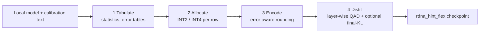

# hi2: quantizer for the rdna_hint_flex weight format

`hi2` converts a local Hugging Face model into a **rdna_hint_flex** checkpoint.
Quantization stores weight rows as 2-bit or 4-bit integers (INT2 or INT4), with
8-bit integers (INT8) available on request. The format adds block parameters,
an optional smoothing vector, and an order-16 Hadamard rotation. It targets AMD
RDNA2 GPUs (gfx1030). The [published measurements](docs/results.md) apply to
specific models and runtime configurations, not every backend.

Choose an allocation-error budget or a target bit rate. The tool assigns fewer
bits to less sensitive rows. Then measure the checkpoint on independent text:
an allocation target is not a model-quality guarantee.



## Start here

1. **Inputs and quantization.** [Install](docs/installation.md), then
   [check model eligibility](docs/getting-started.md#supported-inputs-and-evidence).
   Use a local Hugging Face safetensors directory, not a remote model ID.
   [Prepare separate calibration, tuning and final-test data](docs/evaluation.md#prepare-independent-data).
2. **Validation scope.** [Check structure, size and dense numerical quality](docs/evaluation.md)
   separately. Structural validation does not establish model quality.
   Dense evaluation does not qualify a native low-bit runtime.
3. **Execution and recovery.** Start with the [no-download CPU tutorial](docs/getting-started.md#executed-no-download-cpu-smoke),
   then follow the [first-model walkthrough](docs/getting-started.md#first-model-walkthrough).
   Choose explicit devices and plan resources before a full run.
   Keep the source, data and work paths for [safe recovery](docs/operations.md#resume-and-invalidation).
   Choose [dense export or a separately qualified native runtime](docs/getting-started.md#export-and-native-serving)
   only after validation.

With calibration, the normal recipe starts with **post-training quantization
(PTQ)**. It then uses **quantization-aware distillation (QAD)** to train quantized
layers against the original model. The `default` preset also requests
**final-KL**, a phase that aims to reduce Kullback–Leibler divergence between model
output distributions. Neither allocation nor QAD guarantees final divergence (KLD).
`--no-qad` selects PTQ only. Final-KL can be disabled or skipped if the model does
not fit; check the phase messages.

[usage.md](docs/usage.md) is the canonical command-line interface (CLI) reference.
`python -m hi2 ...` and `hi2 ...` use the same entry point.

## Documentation

| You want to | Read |
| --- | --- |
| Install and quantize a first model | [installation.md](docs/installation.md), [getting-started.md](docs/getting-started.md) |
| Prepare data and interpret checks | [evaluation.md](docs/evaluation.md) |
| Run the tool, pick flags | [usage.md](docs/usage.md) |
| Plan resources, resume, or distribute output | [operations.md](docs/operations.md) |
| Automate with recipes, durable jobs, or Model Context Protocol (MCP) | [usage.md](docs/usage.md#automation-errors-and-recovery), [mcp.md](docs/mcp.md) |
| Find CPU regression tests and process prerequisites | [usage.md](docs/usage.md#development-tests) |
| Run task benchmarks against a server | [bench/README.md](bench/README.md) |
| Understand how it works | [architecture.md](docs/architecture.md) |
| Explore an interactive orientation and educational size estimate, not a quantization result | [overview.html](docs/overview.html) |
| Read the v3.2 serialization reference and design studies | [format-spec.md](docs/format-spec.md) |
| See measured quality and speed | [docs/results.md](docs/results.md) |
| Quantize a mixture-of-experts model | [docs/moe.md](docs/moe.md) |
| Learn about QAD | [docs/qad.md](docs/qad.md) |
| Learn about the cache and speed | [docs/speed.md](docs/speed.md) |
| Review architecture and evaluation work candidates | [docs/architecture-evaluation-roadmap.md](docs/architecture-evaluation-roadmap.md) |
| See the INT8 and final-KL study | [docs/lowbit.md](docs/lowbit.md) |
| Find a script that made a number | [experiments/README.md](experiments/README.md) |

The index of all documents is [docs/README.md](docs/README.md).

## Status

Dense PTQ/QAD and per-expert mixture-of-experts (MoE) PTQ paths are implemented.
Their measured coverage differs. Consult the
[support matrix](docs/getting-started.md#supported-inputs-and-evidence).
The OLMoE measurements do not establish support for MoE QAD, shared-expert
variants, or fused 3-D expert weights on disk.

Native HIP kernels and the HI2-enabled vLLM loader live outside this repository.
Published serving results are historical evidence; this checkout does not provide
a version-pinned, newly validated native installation recipe. Dense numerical
evaluation is not native-loader validation.

## Development tests

Follow the [installation guide](docs/installation.md#checkout-and-virtual-environment)
for the test and optional MCP extras. Run from the checkout with that interpreter:

```bash
python -m pytest -q tests
```

Most tests run on CPU; accelerator-dependent skips are not accelerator acceptance.
MCP tests require the pinned optional SDK: a suite that skips them is not MCP
qualification. Durable-job/MCP tests also need POSIX file locking, signals and real
child processes. See [focused suites and host prerequisites](docs/usage.md#development-tests)
and the [dated MCP compatibility measurements](docs/mcp.md#installation-and-compatibility).
The [CI workflow](.github/workflows/tests.yml) is the executable check definition;
the [recorded environment](docs/installation.md#recorded-environment-and-evidence)
describes previous results, not a fresh run of this checkout.

## License

Apache License 2.0, see [LICENSE](LICENSE).
