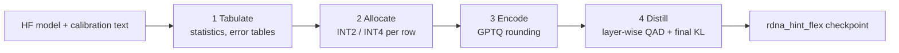

# hi2: quantizer for the rdna_hint_flex weight format

`hi2` converts a Hugging Face model into a **rdna_hint_flex** checkpoint. The format stores
each weight row as INT2 or INT4 (INT8 on request). It adds block parameters, an optional
smoothing vector, and an order-16 Hadamard rotation. The format targets AMD RDNA2
GPUs (gfx1030); the [published measurements](docs/results.md) describe specific
models and runtime configurations, not universal backend support.

The tool picks INT2 where a row matters less and INT4 where it matters more. Choose
a global allocation-error budget or a target bit rate, then measure the resulting
checkpoint on independent text. Neither allocation nor QAD guarantees final KLD.



## Start here

1. [Install in a backend-specific environment](docs/installation.md). The CPU
   import-checked environment and the limits of historical GPU evidence are listed
   separately.
2. [Check model and on-disk layout eligibility](docs/getting-started.md#supported-inputs-and-evidence).
   Inputs are local Hugging Face safetensors directories, not arbitrary model IDs.
3. [Prepare independent calibration, tuning and final-test data](docs/evaluation.md#prepare-independent-data).
4. Follow the [first-model tutorial](docs/getting-started.md): explicit devices,
   dry-run, a small PTQ compatibility smoke, then the full recipe if appropriate.
5. [Validate coverage, stored size and numerical quality](docs/evaluation.md), then
   choose [dense export or a separately qualified native runtime](docs/getting-started.md#export-and-native-serving).

With calibration, the normal recipe is PTQ followed by layer-wise QAD and the
`default` preset's final logit-KL phase. `--no-qad` deliberately selects PTQ only.
Final-KL can be disabled or skipped for model-fit reasons; check the run's phase
messages rather than assuming it ran. [usage.md](docs/usage.md) is the canonical
CLI/options reference; `python -m hi2 ...` and `hi2 ...` use the same entry point.

## Documentation

| You want to | Read |
| --- | --- |
| Install and quantize a first model | [installation.md](docs/installation.md), [getting-started.md](docs/getting-started.md) |
| Prepare data and interpret checks | [evaluation.md](docs/evaluation.md) |
| Run the tool, pick flags | [usage.md](docs/usage.md) |
| Plan resources, resume, or distribute output | [operations.md](docs/operations.md) |
| Automate with recipes, durable jobs, or MCP | [usage.md](docs/usage.md#automation-errors-and-recovery), [mcp.md](docs/mcp.md) |
| Find CPU regression tests and process prerequisites | [usage.md](docs/usage.md#development-tests) |
| Run task benchmarks against a server | [bench/README.md](bench/README.md) |
| Understand how it works | [architecture.md](docs/architecture.md) |
| See the explainer page | [overview.html](docs/overview.html) |
| Read the v3.2 serialization reference and design studies | [format-spec.md](docs/format-spec.md) |
| See measured quality and speed | [docs/results.md](docs/results.md) |
| Quantize a mixture-of-experts model | [docs/moe.md](docs/moe.md) |
| Learn about QAD | [docs/qad.md](docs/qad.md) |
| Learn about the cache and speed | [docs/speed.md](docs/speed.md) |
| See the INT8 and final-KL study | [docs/lowbit.md](docs/lowbit.md) |
| Find a script that made a number | [experiments/README.md](experiments/README.md) |

The index of all documents is [docs/README.md](docs/README.md).

## Status

Dense PTQ/QAD and per-expert MoE PTQ paths are implemented, with different measured
coverage. Consult the [support matrix](docs/getting-started.md#supported-inputs-and-evidence):
MoE QAD, shared-expert variants, and fused 3-D expert weights on disk must not be
inferred supported from the OLMoE measurements.

Native HIP kernels and the HI2-enabled vLLM loader live outside this repository.
Published serving results are historical evidence; this checkout does not provide
a version-pinned, newly validated native installation recipe. Dense numerical
evaluation is not native-loader validation.

## Development tests

Follow the [installation guide](docs/installation.md#checkout-and-virtual-environment)
for the test and optional MCP extras. Run from the checkout with that interpreter:

```bash
python -m pytest -q tests
```

Most tests run on CPU; accelerator-dependent skips are not accelerator acceptance.
MCP tests require the pinned optional SDK: a suite that skips them is not MCP
qualification. Durable-job/MCP tests also need POSIX file locking, signals and real
child processes. See [focused suites and host prerequisites](docs/usage.md#development-tests)
and the [dated MCP compatibility measurements](docs/mcp.md#installation-and-compatibility).
The [CI workflow](.github/workflows/tests.yml) is the executable check definition;
the [recorded environment](docs/installation.md#recorded-environment-and-evidence)
describes previous results, not a fresh run of this checkout.

## License

Apache License 2.0, see [LICENSE](LICENSE).
