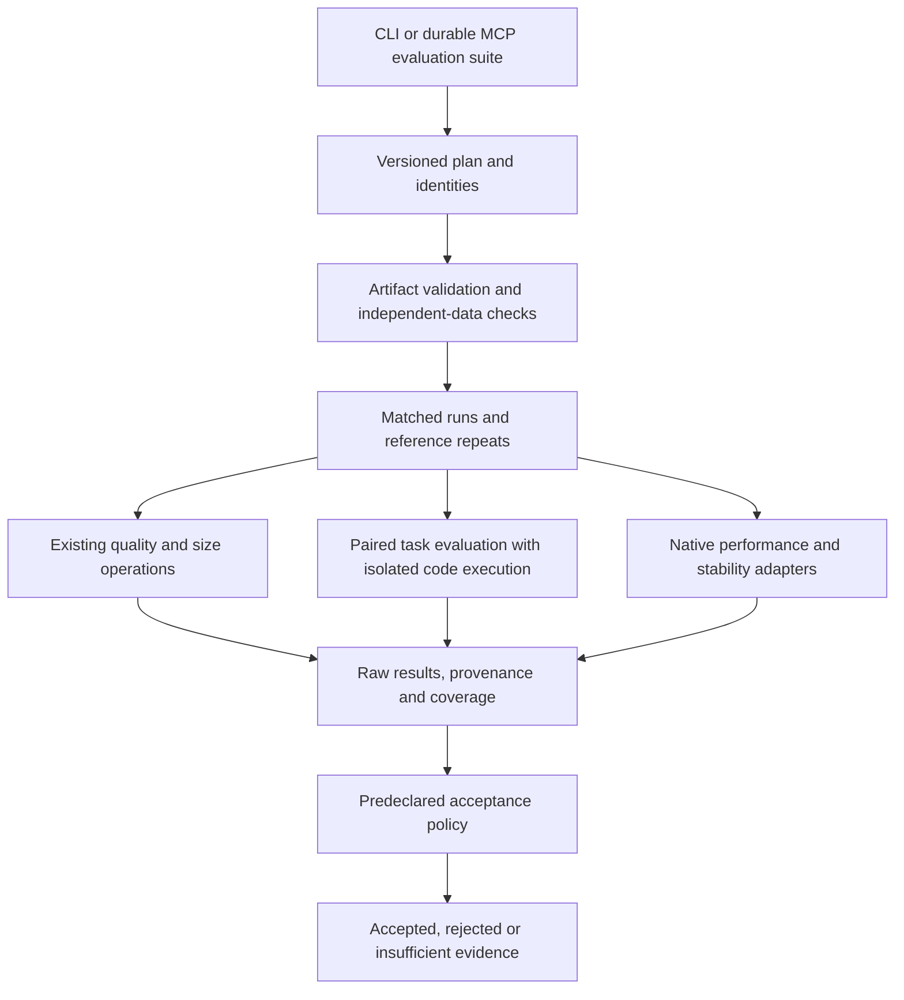

# Architecture, evaluation and research roadmap

Assessment date: **2026-11-05**. Source baseline:
[`8439fca52d`](https://github.com/BlivionIaG/hi2/tree/8439fca52d099a39213ab016b8174f663c4eebdf).
Execution order and live status: **[#94](https://github.com/BlivionIaG/hi2/issues/94)**.

This report separates implemented behavior from proposed work. It consolidates
five investigations of numerical performance, memory/I/O, control architecture,
allocation/quality and format/runtime boundaries, plus selected CPU reproductions.
The integrated `hi2 bench` command below is **planned, not implemented**.
The tickets are not evidence that their features work.

## Decision

Keep the current numerical pipeline and v3.2 representation. Repair composition,
make measurements complete, and establish native runtime qualification before
adding formats or replacing infrastructure. Existing fusion, batching, prefetch,
activation residency and cache reuse are not missing features.

Use these evidence classes throughout:

- **Observed:** exercised on the baseline during this assessment, on CPU.
- **Source:** supported by code inspection; the consequence may remain untested.
- **Historical:** an earlier documented measurement under its original conditions.
- **Proposal:** an unmeasured benefit or design hypothesis, not a speed promise.

No new GPU performance, native-loader support or model-quality improvement was
established by this assessment. The [current architecture](architecture.md)
explains the quantization phases; [evaluation.md](evaluation.md) defines current
metrics and commands. This report explains what to improve next.

## Current architecture and useful boundaries

The baseline has 38 core Python modules and 15,745 physical source lines,
including embedded native-kernel source strings. Large modules are not by
themselves a reason to split files.

| Boundary | Main modules | Responsibility |
| --- | --- | --- |
| Interfaces | `__main__`, `mcp_server`, `mcp_tasks` | CLI presentation and MCP transport |
| Control | `service`, `workspace`, `jobs`, `job_worker`, `runtime` | Resolution, preflight, access policy, supervision, ownership, identity and results |
| Pipeline | `pipeline`, `layerwise` | Calibration, statistics reuse, sensitivity, allocation, PTQ/QAD and publication |
| Numerical work | `stats`, `hessian`, `calibrate`, `allocate`, `encode`, `refine`, `qad`, `finalkl`, `executor`, kernel modules | Candidate errors, row choices, exact encoding, optional training and device work |
| Storage | `format`, `checkpoint`, `stack`, `cache`, `size`, `moe`, `pinned` | Representation, checkpoint I/O, expert layouts, reusable products and transfers |
| Evaluation | `evalq`, `quality`, `tune`, checkout `bench/` | Dense fidelity, acceptance, target selection and served tasks |

The current pipeline collects activation moments and, for GPTQ, Hessian data;
builds candidate error tables; allocates bits/blocks globally; initializes PTQ
or each QAD layer; optionally performs final-KL training; then writes, restacks
and validates the artifact. The QAD path does not first publish a complete PTQ
checkpoint. Native inference kernels live in an external vLLM fork.

Preserve four separate identities:

- `run_id`: intended work and input identity.
- `attempt_id`: one execution or reuse attempt.
- `job_id`: durable scheduling and supervision.
- Artifact identity: the actual published bytes and their production evidence.

A cache entry is a disposable acceleration product, not proof of artifact
correctness. Static import cycles exist across storage helpers, evaluation/service
helpers and MCP helpers; some are intentional lazy imports. No import failure was
observed. Extract a boundary when a real operation needs it, not through a broad
rename or framework rewrite.

### Architecture direction

Keep typed finite operations in `service`; keep CLI formatting and MCP transport
outside. Preserve `workspace` as the authority for paths and capabilities. A new
adapter must not bypass it.

Artifact transformations must regenerate evidence that depends on changed bytes.
Keep immutable production evidence separate from attempt events. Reuse existing
ownership locks and publication rules rather than introducing another manager.

Distinguish what the encoder can represent, what structural validation accepts,
and what a pinned native runtime has actually executed. Resource plans must state
uncertainty; an estimate is not a memory-fit promise.

## Observations and performance priorities

### Four reproduced contract gaps

| Finding | CPU observation | Ticket |
| --- | --- | --- |
| Reader lifetime | A live `StatsView` loaded a Hessian; another process pruned its entry; the same reader then returned `None`. Missing-Sigma paths can select nearest rounding, but a changed full-run output was not measured. | [#64](https://github.com/BlivionIaG/hi2/issues/64) |
| Portable restack | A portable artifact with two experts and six projections validated. Restacking succeeded, but the result failed validation with `config.json: portable checksum/size mismatch`. | [#65](https://github.com/BlivionIaG/hi2/issues/65) |
| K alignment | A synthetic, consistently packed INT2/B32 artifact with R=8 and K=32 passed public validation despite the normative K-multiple-of-64 rule. Normal encoder emission of this shape was not demonstrated. | [#66](https://github.com/BlivionIaG/hi2/issues/66) |
| Recipe types | Core resolution accepted `schema_version: true` and retained fractional `cache_devices: 0.5`. Other numeric checks already reject booleans; the issue is inconsistent declared-type enforcement. | [#67](https://github.com/BlivionIaG/hi2/issues/67) |

These are narrow follow-ups to existing features, not claims that cache locking,
portable export, validation or the shared service are absent.

### CPU execution and timing scope

A no-download random Llama fixture exercised real CLI execution: two layers,
hidden width 128, intermediate width 256, vocabulary 64, 14 quantized linears,
two calibration sequences of 16 tokens, two QAD steps and two final-KL steps.
Math was float32 on CPU, with rotation and sensitivity disabled. This proves
execution paths, not useful language-model quality.

Environment: Python 3.12.13, PyTorch 2.15.0, Transformers 5.22.1, safetensors 0.8.0,
macOS arm64; CPU math thread counts limited to one.

| Case | CLI wall time | Returned numerical total | Interpretation |
| --- | ---: | ---: | --- |
| Empty HI2 application cache | 2.815 s | 0.9 s | Statistics miss; successful checkpoint production |
| Warm cache, new run | 2.544 s | 0.6 s | Statistics/tables hit; another successful production run |
| Completed-run reuse | 1.887 s | 0.6 s, original value | Fresh attempt, reused artifact-production metrics |

One observation per case. Empty application cache is not cold OS page cache.
These are not statistically supported speedups or GPU predictions. Current
numerical totals omit preparation/hash and later restack/validation; the QAD
timer includes final-KL. [#68](https://github.com/BlivionIaG/hi2/issues/68) separates attempt and production evidence.

### Historical measurements that affect priority

| Workload | Recorded cost | Implication |
| --- | --- | --- |
| Qwen3.5-4B cold PTQ | Phase 1 559 s; probe 825 s; encode 97 s; total about 1,485 s | Phase 1 plus probe were about 93% of that run. Eliminating encoding entirely would cap its whole-run gain at about 1.07x. |
| Qwen3.5-4B layer QAD | Existing fusion reduced a step from 550 to 400 ms; layer forward/backward remained about 376 ms | The old unfused decode cost is not a new optimization opportunity. |
| Completed 27B QAD | Layer QAD 247 min plus final-KL 470.8 min | Final-KL was about 66% of these two training phases, not necessarily of full CLI time. Profile it separately. |

Sources: [PTQ measurements][ptq-cost], [QAD step profile][qad-step],
[27B phase costs][qad-cost]. These are different workloads, not one benchmark
matrix. They justify profiling, not a predicted gain from a particular kernel.

## Original ranked work candidates

The 26 recommendations became 30 atomic tickets. R8, R9, R14 and R20 each contain
two independently deliverable changes. The live roadmap may adjust execution
order as dependencies and measurements become available.

| Rank | Work | Tickets | Main gate |
| ---: | --- | --- | --- |
| 1 | Active cache-reader leases | [#64](https://github.com/BlivionIaG/hi2/issues/64) | CPU multiprocess lifetime and real cache-backed workflow |
| 2 | Portable restack integrity | [#65](https://github.com/BlivionIaG/hi2/issues/65) | CPU transformed artifact validation and failure cleanup |
| 3 | Normative K alignment | [#66](https://github.com/BlivionIaG/hi2/issues/66) | Public structural validation boundaries |
| 4 | Shared declared-type validation | [#67](https://github.com/BlivionIaG/hi2/issues/67) | CLI, recipe, service and MCP agreement |
| 5 | Attempt versus production timing | [#68](https://github.com/BlivionIaG/hi2/issues/68) | Cold/warm/reuse accounting; GPU trace for device attribution |
| 6 | Group-at-a-time cached table replay | [#69](https://github.com/BlivionIaG/hi2/issues/69) | Identical tables/outputs; GPU memory evidence for claims |
| 7 | One compact calibration preparation | [#70](https://github.com/BlivionIaG/hi2/issues/70) | Exact IDs, seed order, lifetimes and identities |
| 8 | Native target selection; build isolation | [#71](https://github.com/BlivionIaG/hi2/issues/71), [#72](https://github.com/BlivionIaG/hi2/issues/72) | Real architecture-specific and concurrent native builds |
| 9 | Artifact requirements; pinned runtime qualification | [#73](https://github.com/BlivionIaG/hi2/issues/73), [#74](https://github.com/BlivionIaG/hi2/issues/74) | CPU requirements plus actual native execution |
| 10 | Tuning provenance and final-test exclusion | [#75](https://github.com/BlivionIaG/hi2/issues/75) | End-to-end data lineage and overlap rejection |
| 11 | Confirm selected target-KLD point | [#76](https://github.com/BlivionIaG/hi2/issues/76) | Measured versus predicted quality and bounded search |
| 12 | Token/context identity for score gaps | [#77](https://github.com/BlivionIaG/hi2/issues/77) | Correct pairing and real endpoint records |
| 13 | Reuse contiguous shared Hessian factors | [#78](https://github.com/BlivionIaG/hi2/issues/78) | Exact outputs and measured GPU allocations |
| 14 | Cache final-KL transform flags; batch metric transfers | [#79](https://github.com/BlivionIaG/hi2/issues/79), [#80](https://github.com/BlivionIaG/hi2/issues/80) | Same numerical decisions and actual synchronization evidence |
| 15 | Inner final-KL checkpoint tradeoff | [#81](https://github.com/BlivionIaG/hi2/issues/81) | GPU recomputation/memory study, adopt or reject |
| 16 | Fixed-code final-KL decoder | [#82](https://github.com/BlivionIaG/hi2/issues/82) | Profile first; exact forward, correct gradients and real training |
| 17 | Byte-bounded pending Sigma writes | [#83](https://github.com/BlivionIaG/hi2/issues/83) | Queue lifetime/failure behavior and actual high-water |
| 18 | Aggregate pinned staging bound | [#84](https://github.com/BlivionIaG/hi2/issues/84) | Real mixed-shape/dtype/thread GPU transfers |
| 19 | Sharing-aware device admission | [#85](https://github.com/BlivionIaG/hi2/issues/85) | Output invariants, conservative peaks and native timings |
| 20 | Shared tuning operation; durable tuning jobs | [#86](https://github.com/BlivionIaG/hi2/issues/86), [#87](https://github.com/BlivionIaG/hi2/issues/87) | Real service/CLI then reconnectable MCP lifecycle |
| 21 | Per-operation capability states | [#88](https://github.com/BlivionIaG/hi2/issues/88) | Separate installed, eligible, executable and qualified |
| 22 | Allocation tradeoff explanation | [#89](https://github.com/BlivionIaG/hi2/issues/89) | Auditable objective/constraint/byte accounting |
| 23 | Reachable QAD stopping checks | [#90](https://github.com/BlivionIaG/hi2/issues/90) | Schedule transitions plus real quality/work tradeoff |
| 24 | Predeclared regression policy | [#91](https://github.com/BlivionIaG/hi2/issues/91) | Accepted, rejected and insufficient-evidence distinctions |
| 25 | Numerical producer identity audit | [#92](https://github.com/BlivionIaG/hi2/issues/92) | Equivalence evidence or compatible cache invalidation |
| 26 | Queue contention study | [#93](https://github.com/BlivionIaG/hi2/issues/93) | CPU multiprocess measurements before scheduler changes |

Existing [#39](https://github.com/BlivionIaG/hi2/issues/39) owns the native serving guide and [#53](https://github.com/BlivionIaG/hi2/issues/53) owns broader model
qualification. Neither was replaced with a duplicate ticket.

## Proposed integrated evaluation command

The proposed entry point is **`hi2 bench`** ([#101](https://github.com/BlivionIaG/hi2/issues/101)), over a shared service operation.
Keep **`hi2 quality`** as the focused numerical-fidelity command. Reuse its
evaluator and thresholds; do not create a second KL/PPL implementation.

Today, `hi2 validate`, `verify`, `size`, `eval` and `quality` are available.
Task runs use checkout scripts `bench/run.py` and `bench/compare.py`; `bench/`
is not installed by package discovery. Dense evaluation reconstructs fp16 weights
and does not test native HI2 kernels. The current [benchmark guide](../bench/README.md)
describes commands, server API requirements and execution risks.

The following diagram is the **planned workflow**, not current command behavior:

### What a good-quant decision must measure

| Dimension | Required evidence | Existing work and missing tickets |
| --- | --- | --- |
| Fidelity | Held-out full-distribution KL, PPL and PPL ratio against the matching source; top-1 agreement and distribution overlap; actual serialized size | Existing `quality`/`size`, orchestrated by [#101](https://github.com/BlivionIaG/hi2/issues/101) |
| Utility | Same math, coding, instruction, tool-use and long-context items; per-task outcomes and paired uncertainty | Installed runner [#96](https://github.com/BlivionIaG/hi2/issues/96); isolated code [#97](https://github.com/BlivionIaG/hi2/issues/97); optional standard-task adapter [#103](https://github.com/BlivionIaG/hi2/issues/103) and EvalPlus [#104](https://github.com/BlivionIaG/hi2/issues/104) |
| Deployment | Actual native load/execution, peak memory, prefill/decode and aggregate throughput, TTFT/inter-token latency, errors and repeated-request stability | Qualification [#74](https://github.com/BlivionIaG/hi2/issues/74); performance [#98](https://github.com/BlivionIaG/hi2/issues/98); stability [#99](https://github.com/BlivionIaG/hi2/issues/99) |
| Fair comparison | Matching input items, tokenizer/template, thinking/decoding settings and context budget; pinned model/artifact/task identity; disclosed runtime/dtype differences | Shared plan [#95](https://github.com/BlivionIaG/hi2/issues/95); token-score pairing [#77](https://github.com/BlivionIaG/hi2/issues/77); cross-GGUF study [#105](https://github.com/BlivionIaG/hi2/issues/105) |
| Independent evidence | Final-test data outside calibration and tuning; predeclared policy; repeated reference runs to estimate runtime noise | Provenance [#75](https://github.com/BlivionIaG/hi2/issues/75); repeat protocol [#100](https://github.com/BlivionIaG/hi2/issues/100); acceptance [#91](https://github.com/BlivionIaG/hi2/issues/91) |

Completion and acceptance are different. A wrong answer is a completed item;
a request failure is missing evidence. A full-suite result cannot be accepted
when a required phase is skipped, incompatible or unmeasured. An explicit
CPU-only selection can complete, but must state that native evidence is absent.
There is no universal KL or task-score threshold that certifies every use case.

A selected-token log-probability gap is not full-distribution KL. Expected
acceptance from distribution overlap is not measured speculative-serving
acceptance. Client wall time is not native-kernel time. Reference run-to-run
spread is different from paired item-bootstrap uncertainty; report both.

### Delivery boundaries

- [#95](https://github.com/BlivionIaG/hi2/issues/95) defines the plan and comparison identity before expensive execution.
- [#96](https://github.com/BlivionIaG/hi2/issues/96) makes the existing runner/resources usable outside a checkout.
- [#97](https://github.com/BlivionIaG/hi2/issues/97) provides real isolation. The current `bench/sandbox.py` is not a security
  sandbox; do not silently run generated code on the host.
- [#98](https://github.com/BlivionIaG/hi2/issues/98) and [#99](https://github.com/BlivionIaG/hi2/issues/99) require actual native runtimes. CPU protocol tests cannot qualify
  GPU memory, speed or graph replay.
- [#100](https://github.com/BlivionIaG/hi2/issues/100) records repeats/restarts/cache state without treating greedy decoding as
  a determinism guarantee.
- [#101](https://github.com/BlivionIaG/hi2/issues/101) composes the measured stages and existing policy; no scaffold-only success.
- [#102](https://github.com/BlivionIaG/hi2/issues/102) exposes that same operation as reconnectable MCP jobs, preserving existing
  idempotency, output/device leases and workspace capabilities.
- [#106](https://github.com/BlivionIaG/hi2/issues/106) maintains a small, evidence-backed dependency matrix and reproducible
  environments, rather than blindly pinning all dependencies.

The optional integrations are research: [lm-evaluation-harness][lm-eval] ([#103](https://github.com/BlivionIaG/hi2/issues/103)),
[EvalPlus][evalplus] ([#104](https://github.com/BlivionIaG/hi2/issues/104)) and [llama.cpp GGUF evaluation][llama-ppl] ([#105](https://github.com/BlivionIaG/hi2/issues/105)).
Pin versions and task protocols. The local generated `ifeval` task is not an
official IFEval result. GGUF tools do not provide an HI2 loader. Keep numerical
cross-format comparisons separate from native speed and memory comparisons.

## Remaining format and algorithm explorations

These tickets request measurements and an adopt/reject decision. They do not
change defaults or authorize an unversioned extension to v3.2.

### B128: fewer block parameters, potentially more quantization error

B128 means 128 weights share one affine ladder along K, compared with 64 for
B64. HI2 stores two parameter bytes per block, so the modeled parameter cost
is `16 / B` bits per weight.

| Block | Parameter overhead | INT2 codes plus block parameters |
| --- | ---: | ---: |
| B64, implemented | 0.250 bpw | 2.250 bpw |
| B128, proposed | 0.125 bpw | 2.125 bpw |

This excludes row constants, offsets, smoothing, dense tensors and other
serialized metadata. It is not whole-checkpoint bpw. B128 does not reduce the
number of INT2 code bits; it reduces the frequency of ladder parameters.

The larger block must fit more weights with the same four INT2 reconstruction
levels. Error can increase, and the allocator may compensate with higher-bit
rows, removing the size benefit. Native decoding may save parameter traffic,
but arithmetic/dispatch constraints can dominate. K divisibility, GPTQ/QAD
handling, validation and external loader/kernels need explicit support.

**Study [#107](https://github.com/BlivionIaG/hi2/issues/107):** first compare actual size and independent quality against current
mixed blocks/rows. Proceed to native prototypes only if that frontier is useful.
Do not silently add B128 to the v3.2 contract. See [normative storage][format].

### Wider rotations: not an assumed improvement

Current rotation groups have width 16. Wider groups may spread outliers across
more columns, but add butterfly stages and activation-side costs. They must
preserve the paired weight/activation basis, shared-input transforms and block
alignment. They are not free preprocessing when activations also need rotation.

Historical small-model measurements found groups 16/64/128 within about 1%
after smoothing ([design notes](design-notes.md#2-where-rotation-helps-and-where-it-does-not)).
That limits the claim; it is not a broad proof of either equivalence or benefit.
**Study [#108](https://github.com/BlivionIaG/hi2/issues/108)** needs a new workload-specific reason, independent quality and
native timings, with versioned semantics if the representation changes.

### Outlier side channel: residual values, not a security mechanism

An outlier side channel stores selected high-precision corrections beside the
low-bit base weights. The model reconstructs the base plus those corrections.
Indices, residual values, gathers and correction work all count toward cost.

**Study [#109](https://github.com/BlivionIaG/hi2/issues/109)** compares this with the existing INT2/INT4/optional INT8 row mix,
not with uniform INT2 alone. Require equal-size/equal-quality comparisons and
native dense/MoE measurements. Reject it if metadata or runtime overhead erases
the gain. A new residual representation needs explicit decode/version rules.

### Latency-aware allocation: measured costs before a new objective

The current objective is weighted error versus modeled bits, not serving latency.
Per-row latency is not necessarily additive. Mixed kernels, input shapes, expert
routing, prefill/decode, concurrency and activation mode affect real cost.

**Study [#110](https://github.com/BlivionIaG/hi2/issues/110)** starts from [#98](https://github.com/BlivionIaG/hi2/issues/98) native measurements and [#73](https://github.com/BlivionIaG/hi2/issues/73)/#74 qualified runtime
requirements. Validate a cost model on held-out shapes/workloads and compare
quality, actual size and latency together. A microbenchmark win that worsens the
full serving workload is not an improvement. [#113](https://github.com/BlivionIaG/hi2/issues/113) separately studies filtering
existing candidates to a qualified runtime profile; capability filtering is not
itself latency optimization.

### INT3: low-priority feasibility only

INT3 is not assumed relevant to the performance target. Existing INT2/INT4 mixing
already provides intermediate average precision. Three-bit packing requires a
new extraction contract, including word-boundary behavior, rather than the
current power-of-two packing. Smaller nominal codes do not establish faster
decode on RDNA2.

**Study [#111](https://github.com/BlivionIaG/hi2/issues/111) is P3:** screen the quality/actual-size opportunity first. Only
consider native implementation if the expected benefit can survive packing,
metadata and decode costs. An evidence-backed rejection is a valid outcome.

### Other candidates and explicit limits

| Study | Question | Gate |
| --- | --- | --- |
| [#112](https://github.com/BlivionIaG/hi2/issues/112) nonlinear/vector/trellis codebooks | Is there enough equal-size quality gain to justify a more complex decode path? | New semantics, all metadata bytes, real native cost and independent quality |
| [#113](https://github.com/BlivionIaG/hi2/issues/113) runtime-constrained candidates | Does filtering existing choices to a qualified runtime help? | Profile identity, feasible choices and changed relative error floor; no assumed speedup |
| [#114](https://github.com/BlivionIaG/hi2/issues/114) final-KL token sampling | Does the existing `final_tokens` option save worthwhile head/loss work? | Decoder work is not removed; measure final quality and whole-run cost |
| [#115](https://github.com/BlivionIaG/hi2/issues/115) selective QAD precision | Can a narrower mixed-precision branch avoid the known full-FP16 failure? | Numerical explanation, complete GPU training and held-out quality; do not rerun the known failure merely to confirm it |
| [#116](https://github.com/BlivionIaG/hi2/issues/116) FP16 Hessian policy | Where is the existing lossy cache option a useful tradeoff? | Cache/host/device cost, changed codes and model quality; no exactness claim |
| [#117](https://github.com/BlivionIaG/hi2/issues/117) direct stacked publication | Is staging/restack I/O material enough to justify a writer change? | Profile first, then artifact equivalence, ownership and interruption safety |

[Full-FP16 QAD history][fp16-qad] records poor learning and dtype failures.
[FP16 Hessian history][fp16-sigma] records changed codes. These are constraints,
not default settings to promote from theoretical throughput.

Already-slower broad phase-1 table batching, removal of safe staging without
transfer evidence, mtime-only model identities, unbounded global factor caches
and a distributed scheduler/framework rewrite are **not** implementation backlog.
The queue study [#93](https://github.com/BlivionIaG/hi2/issues/93) addresses observed contention if it becomes material; it
does not authorize a new scheduler by assumption.

## Validation and next order

1. Fix the four reproduced contract gaps.
2. Establish timing, comparison identities and independent-data lineage.
3. Build evaluation plan/packaging/isolation and unblocked CPU improvements.
4. Qualify native builds/runtime and complete native evaluation stages.
5. Select GPU optimizations using profiles; run bounded format/training studies
   only when their prerequisites and acceptance criteria justify them.

Independent CPU work need not wait for GPU access. Each change needs relevant
consumer-visible regressions, a real changed-path smoke and updated documentation.
GPU-dependent changes stay draft/unqualified until the required evidence exists.
For performance claims, pin model/runtime/config/device, state cache warmth,
measure whole-run and phase costs plus peaks, repeat runs and verify correct
output. Training/policy changes also need untouched final data and utility tests.

The live checklist in [#94](https://github.com/BlivionIaG/hi2/issues/94) tracks all 53 new tickets plus existing [#39](https://github.com/BlivionIaG/hi2/issues/39)/#53.
Update tickets with actual results; revise priorities after measurement rather
than automatically implement every proposal.

[ptq-cost]: https://github.com/BlivionIaG/hi2/blob/8439fca52d099a39213ab016b8174f663c4eebdf/docs/speed.md#L169-L220
[qad-step]: https://github.com/BlivionIaG/hi2/blob/8439fca52d099a39213ab016b8174f663c4eebdf/docs/qad.md#L289-L312
[qad-cost]: https://github.com/BlivionIaG/hi2/blob/8439fca52d099a39213ab016b8174f663c4eebdf/docs/qad.md#L34-L46
[format]: https://github.com/BlivionIaG/hi2/blob/8439fca52d099a39213ab016b8174f663c4eebdf/docs/format-spec.md#L40-L123
[fp16-qad]: https://github.com/BlivionIaG/hi2/blob/8439fca52d099a39213ab016b8174f663c4eebdf/docs/qad.md#L643-L695
[fp16-sigma]: https://github.com/BlivionIaG/hi2/blob/8439fca52d099a39213ab016b8174f663c4eebdf/docs/speed.md#L278-L283
[lm-eval]: https://github.com/EleutherAI/lm-evaluation-harness
[evalplus]: https://github.com/evalplus/evalplus
[llama-ppl]: https://github.com/ggml-org/llama.cpp/blob/master/tools/perplexity/README.md
