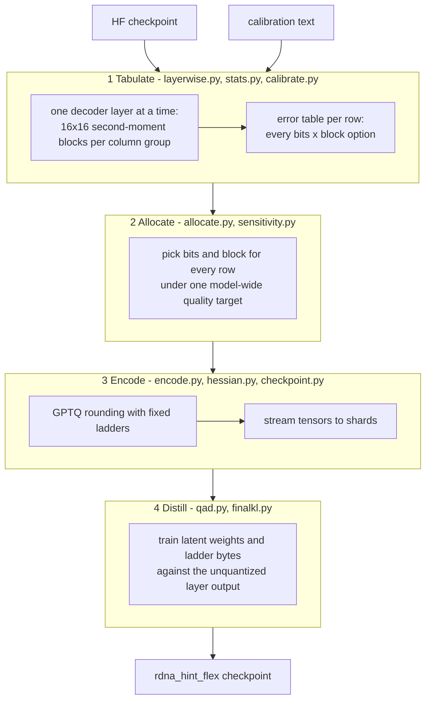
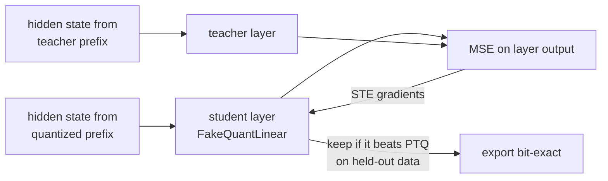
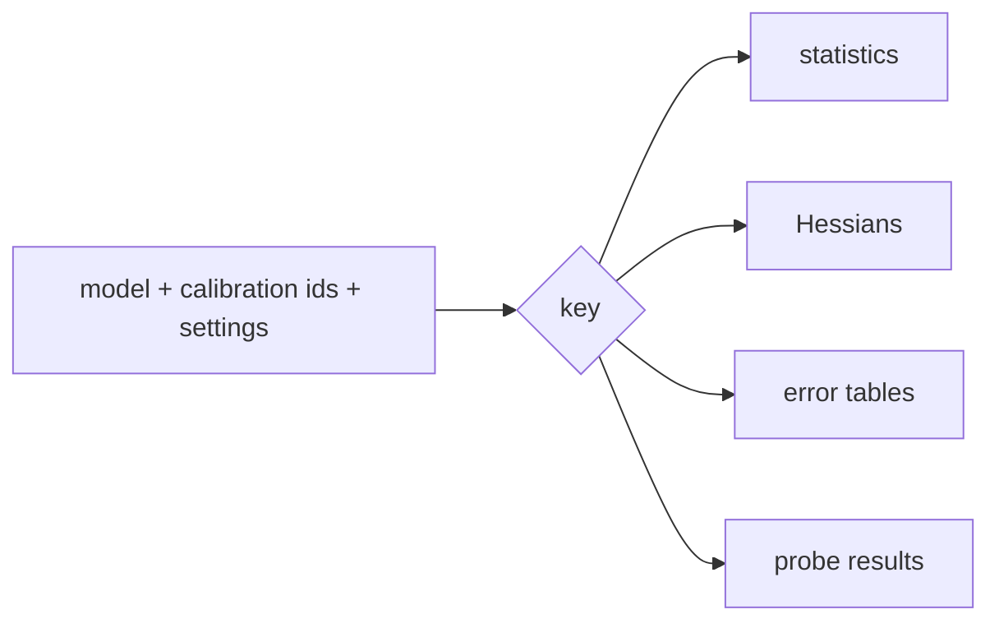

# How hi2 works

`hi2` runs four phases. Each phase reads the output of the one before it. Phases 1 and 2
make the plan. Phases 3 and 4 make the checkpoint.

## Phase 1: tabulate

The tool copies one decoder layer to a compute device. It runs the calibration sequences
through that layer. Hooks collect, for every Linear, a 16x16 second-moment block for each
column group. This is small: `K * 16` floats per tensor. It is enough to compute the
activation-weighted error of every row in the rotated basis without keeping activations.

Each Linear gets a table: the weighted squared error of every row under every candidate
(INT2 or INT4, block 16, 32 or 64). INT8 candidates exist and are off by default.

## Phase 2: allocate

Every row of the whole model chooses its candidate. The tool minimizes bits under one
model-wide error limit (`--max-error-ratio`), or minimizes error under a bit budget
(`--target-bpw`). A sensitivity probe gives each tensor a weight, so errors in sensitive
tensors cost more. The result is a mix: INT2 for rows that matter less, INT4 for the rest.

## Phase 3: encode

The tool streams the checkpoint again. It encodes each tensor with its picks. Each block
stores `w = fp16(lo + code * step)`. Per-row fp16 constants scale 8-bit `lo` and `step`
bytes. GPTQ rounding picks the codes with the Hessian and corrects the error as it moves
along the columns. The ladders stay fixed, so rounding changes only which codes win.

Tensors are written as `<name>.hi2_*`. Other tensors are copied.

## Phase 4: distill (QAD)

QAD trains one layer at a time. The student layer is a fake-quantized copy that follows the
exact decode of the format. Its input is the hidden state of the already quantized prefix.
Its target is the output of the unquantized layer. Gradients pass through the rounding with
a straight-through estimator.

Row picks, smoothing vectors, and rotation flags stay as PTQ chose them. A layer keeps its
PTQ encoding when training does not beat it on held-out calibration data. An optional last
phase (`--qad-final-kl`) trains a few parameters against the full logits.

## Module map

| Module | Job |
| --- | --- |
| `__main__.py` | Command line: `quantize`, `verify`, `eval`, `export-dense`, `restack`, `cache`. |
| `pipeline.py` | The phases, `RunConfig`, resume logic. |
| `format.py` | The storage format, decode, and reference semantics. |
| `encode.py` | Block encoder: least-squares fit of `lo` and `step`, 8-bit parameters, code assignment. |
| `calibrate.py` | Candidate tables per tensor. |
| `layerwise.py`, `stats.py` | Layer-by-layer statistics collection. |
| `hessian.py`, `gptq_kernel.py` | Hessian-aware rounding. The kernel is a fused HIP loop for gfx10 and gfx11. |
| `allocate.py`, `sensitivity.py` | Global allocation and the sensitivity probe. |
| `qad.py`, `finalkl.py` | Layer-wise distillation and the final logit-KL phase. |
| `moe.py`, `stack.py` | Expert views, routed-token statistics, the stacked layout. |
| `checkpoint.py` | Shard enumeration, the streaming writer, verification. |
| `cache.py` | The persistent cache. |
| `executor.py` | Compute placement on one or more devices. |
| `evalq.py` | Perplexity, KLD, and top-1 agreement on held-out text. |
| `size.py` | Byte accounting of a checkpoint (`hi2 size`). |
| `calib.py` | Mixed-domain calibration text (`hi2 calib`). |

## What the cache holds

The cache key is the content of the inputs, so the Hessians survive a change of target,
ratio, rounding, smoothing, rotation, or candidates. See [speed.md](speed.md).

## Boundaries

* The tool writes checkpoints. The vLLM fork only reads them. The contract between them is
  the tensor layout in [format-spec.md](format-spec.md).
* Calibration and QAD live only in this tool. The runtime does not contain them.
* The tool changes no model code. `eval` runs the original architecture on dequantized
  weights.
