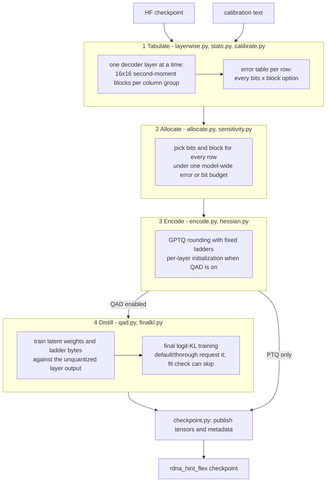
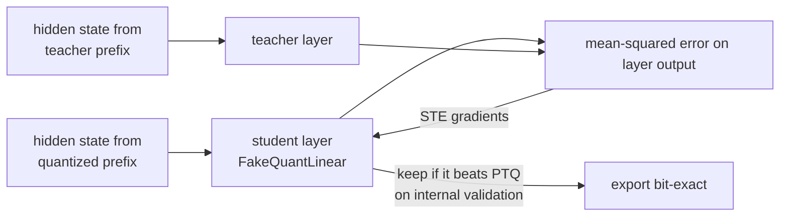
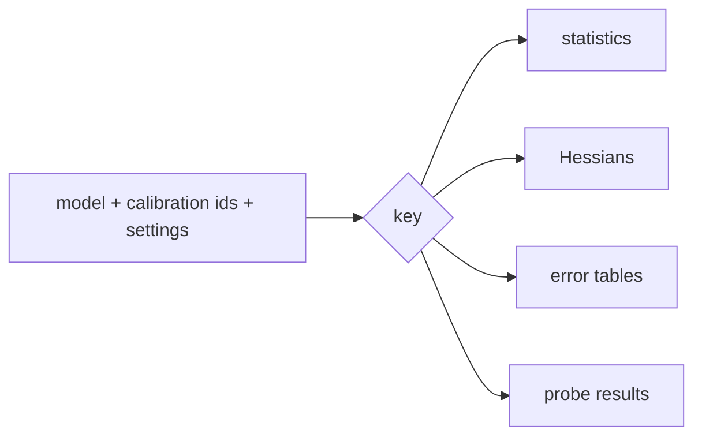

# How hi2 works

`hi2` has four conceptual phases. Phases 1 and 2 select the allocation.
Post-training quantization (**PTQ**) then encodes the weights.
With quantization-aware distillation (**QAD**) enabled, PTQ initializes each
layer before training. The final streaming writer publishes the trained
tensors afterwards; it does not first publish a complete PTQ checkpoint.
PTQ-only runs skip distillation.

## Phase 1: tabulate

The tool copies one decoder layer to a compute device. It runs the calibration sequences
through that layer. Hooks collect, for every Linear, a 16x16 second-moment block for each
column group. For input width `K`, this uses `K * 16` floats per tensor.
These blocks let the tool compute each row's activation-weighted error in the
rotated basis without keeping the activations.

Each Linear gets a table: the weighted squared error of every row under every candidate
(INT2 or INT4, block 16, 32 or 64). INT8 candidates exist and are off by default.

## Phase 2: allocate

Every row of the whole model chooses its candidate. The tool minimizes bits under one
model-wide error limit (`--max-error-ratio`), or minimizes error under a bit budget
(`--target-bpw`). A sensitivity probe gives each tensor a weight, so errors in sensitive
tensors cost more. The result is a mix: INT2 for rows that matter less, INT4 for the rest.

The quality constraint is global: the summed sensitivity-weighted candidate
errors must fit R times the summed best-candidate floor. A row may exceed R
times its own minimum; the sum, not each row, is constrained. This dimensionless
allocation proxy is not a bound on end-to-end Kullback–Leibler divergence (KLD)
([evaluation.md](evaluation.md#allocation-and-kld-targets)).

## Phase 3: encode

The tool streams the checkpoint again. It encodes each tensor with its picks. Each block
stores `w = fp16(lo + code * step)`. Per-row fp16 constants scale 8-bit `lo` and `step`
bytes. GPTQ rounding picks the codes with the Hessian and corrects the error as it moves
along the columns. The ladders stay fixed, so rounding changes only which codes win.

Tensors are written as `<name>.hi2_*`. Other tensors are copied.

## Phase 4: distill (QAD)

QAD trains one layer at a time. The student layer is a fake-quantized copy that follows the
exact decode of the format. Its input is the hidden state of the already quantized prefix.
Its target is the unquantized teacher layer's output on the teacher prefix.
A straight-through estimator (STE) passes gradients through rounding.

Row picks, smoothing vectors, and rotation flags stay as PTQ chose them.
Keep-best selects among evaluated local states, including PTQ. It does not
guarantee final-corpus KLD or task accuracy.

The final logit-KL **training** phase (`--qad-final-kl`) trains only ladder bytes
and, by default, norms; codes stay fixed. The `default` and `thorough` presets
request 200 steps. The `fast` preset requests none, and an explicit 0 disables it.
The phase shards the student across devices and uses saved teacher head inputs
when available. A failed model-fit estimate skips it with a note.
Skipped training is not completed training, and completed training is not
independent final quality evaluation. Use `quality` on separate final-test text
to measure and accept or reject the published artifact.

## Module map

| Module | Job |
| --- | --- |
| `__main__.py` | Command line: `quantize`, `verify`, `eval`, `export-dense`, `restack`, `calib`, `size`, `cache`. |
| `pipeline.py` | The phases, `RunConfig`, resume logic. |
| `format.py` | The storage format, decode, and reference semantics. |
| `encode.py` | Block encoder: least-squares fit of `lo` and `step`, 8-bit parameters, code assignment. |
| `calibrate.py` | Candidate tables per tensor. |
| `layerwise.py`, `stats.py` | Layer-by-layer statistics collection. |
| `hessian.py`, `gptq_kernel.py` | Hessian-aware rounding. The kernel is a fused HIP loop for gfx10 and gfx11. |
| `allocate.py`, `sensitivity.py` | Global allocation and the sensitivity probe. |
| `qad.py`, `finalkl.py` | Layer-wise distillation and the final logit-KL phase. |
| `moe.py`, `stack.py` | Expert views, routed-token statistics, the stacked layout. |
| `checkpoint.py` | Shard enumeration, the streaming writer, verification. |
| `cache.py` | The persistent cache. |
| `executor.py` | Compute placement on one or more devices. |
| `evalq.py` | Perplexity, KLD, and top-1 agreement on held-out text. |
| `size.py` | Byte accounting of a checkpoint (`hi2 size`). |
| `calib.py` | Mixed-domain calibration text (`hi2 calib`). |

## What the cache holds

The **cache** stores reusable phase products. The **workdir** stores one run's
identity and recovery state. The **output** stores the published checkpoint and
reports. Workdir and output reuse require a matching `run_id`; each execution
gets a fresh `attempt_id`. A durable submission has a separate `job_id`.
See [identity fields and paths](usage.md#cache-and-work-directory).

Statistics keys include sampled token IDs, the `sha256-content-v1` model
fingerprint and relevant settings. Compatible Hessians can survive allocation
and encoder changes. The model fingerprint hashes full config/index/shard
contents and relative filenames. Statistics version 2 invalidated the earlier
names-and-sizes-only identity; current `STATS_VERSION=3` also includes active
auxiliary model inputs by canonical path and full SHA-256.
Hashing costs a checkpoint read and does not permit changing inputs during
execution. See [speed.md](speed.md#the-cache) and
[recovery rules](operations.md#resume-and-invalidation).

## Boundaries

* The tool writes checkpoints. The vLLM fork only reads them. The contract between them is
  the tensor layout in [format-spec.md](format-spec.md).
* Calibration and QAD live only in this tool. The runtime does not contain them.
* The tool changes no model code. `eval` runs the original architecture on dequantized
  weights.
